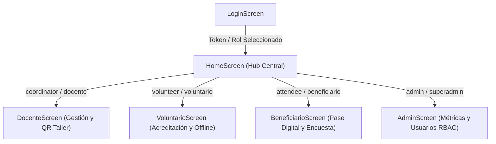

# Especificación de Pantallas y Matriz de Roles (RBAC) — SyncPass Móvil

> **Proyecto:** SyncPass Móvil (Jetpack Compose / Kotlin)  
> **Arquitectura:** MVVM + Clean Architecture + Navigation Compose  
> **Autor:** Mariano Acevedo ([@NanooDev](https://github.com/NanooDev))

---

## 1. Matriz de Roles y Accesos

El sistema implementa 4 perfiles de usuario diferenciados según el caso de negocio de Vinculación con el Medio:

---

## 2. Detalle de Pantallas Implementadas

### 2.1 Pantalla de Login (`ui/login/LoginScreen.kt`)
- **Propósito:** Autenticación institucional federada y local.
- **Componentes:**
  - Formulario con campos de correo institucional y contraseña con toggle de visibilidad.
  - Botón oficial *"Continuar con Amazon Cognito"* conectado al módulo `cognito-auth` (Hosted UI con PKCE).
  - **Panel de Acceso Directo por Rol (Evaluación):** Permite ingresar en 1 clic como Docente, Voluntario, Beneficiario o Administrador para facilitar la revisión del docente evaluador.

### 2.2 Pantalla Principal / Hub (`ui/home/HomeScreen.kt`)
- **Propósito:** Panel centralizador de módulos según el rol del usuario autenticado.
- **Componentes:**
  - Tarjeta de sesión con correo decodificado del JWT, rol activo y emisor.
  - Tarjetas interactivas de navegación hacia los 4 módulos temáticos.
  - Botón de cierre de sesión seguro.

### 2.3 Pantalla Docente / Coordinador (`ui/docente/DocenteScreen.kt`)
- **Propósito:** Gestión y supervisión del quórum territorial.
- **Componentes:**
  - Listado de talleres comunitarios (*Alfabetización Digital*, *Huertos Sostenibles*, *Primeros Auxilios*).
  - Indicador de progreso de quórum (ej. 28/40 cupos ocupados).
  - **Componente Generador de Código QR (`QrCodeView`):** Renderiza en pantalla el código QR oficial del evento para su proyección en la sede o impresión.
  - Botón para descargar acta de asistencia en PDF.

### 2.4 Pantalla Estudiante Voluntario (`ui/voluntario/VoluntarioScreen.kt`)
- **Propósito:** Operación en terreno y acreditación de asistentes.
- **Componentes:**
  - **Lector de Códigos QR (`QrScannerView`):** Visor con retícula animada por Canvas y botón de simulación de escaneo rápido de pases.
  - Campo de acreditación manual por RUT para vecinos que asistan sin teléfono móvil.
  - **Control de Modo Offline / Online:** Switch de conectividad y badge de estado.
  - Contador de registros locales pendientes de sincronizar con botón *"Sincronizar ahora con la nube"*.
  - Lista histórica de asistencias acreditadas durante la jornada con sello de hora.

### 2.5 Pantalla Beneficiario Comunitario (`ui/beneficiario/BeneficiarioScreen.kt`)
- **Propósito:** Acreditación de entrada y evaluación ciudadana inmediata.
- **Componentes:**
  - **Pase Digital SyncPass:** Código QR personal e intransferible del asistente.
  - Información del taller en el que se encuentra inscrito.
  - **Módulo de Encuesta Inmediata:** Calificación de 1 a 5, evaluación de utilidad del taller y caja de comentarios libres.

### 2.6 Pantalla Administrador General (`ui/admin/AdminScreen.kt`)
- **Propósito:** Supervisión de impacto territorial y gobernanza de datos.
- **Componentes:**
  - Cuadrícula de indicadores clave (KPIs): Total de talleres realizados, beneficiarios acreditados y tasa de satisfacción.
  - Tabla de usuarios registrados con sus respectivos roles y estados en el sistema.
