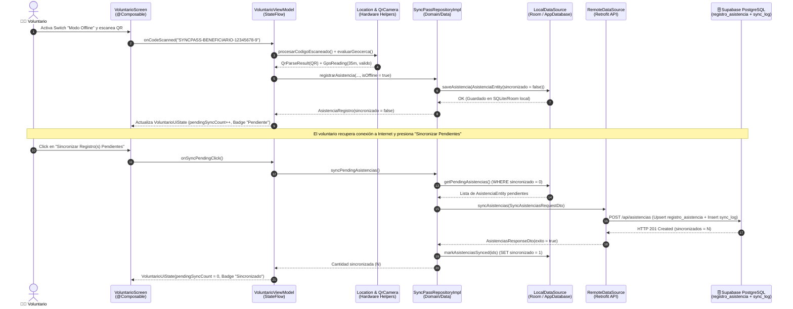

# Levantamiento Funcional y Alcance del Proyecto – SyncPass (`ALCANCE.md`)

**Proyecto:** SyncPass – Sistema de Acreditación Digital para Vinculación Comunitaria  
**Asignatura:** Desarrollo de Aplicaciones Móviles Nativas (Kotlin) & Full Stack II · Duoc UC  
**Integrantes:** Mariano Acevedo · Álvaro León  

---

## 1. Propósito y Problemática de Negocio

Las actividades territoriales de **Vinculación con el Medio de Duoc UC** (talleres de alfabetización digital, operativos comunitarios y charlas vecinales) suelen ejecutarse en sedes sociales o zonas rurales con **conectividad móvil inestable o inexistente**.  
Históricamente, el control de asistencia en papel provocaba pérdida de registros, imposibilidad de verificar si la marcación ocurrió realmente en el recinto asignado, demoras en la consolidación de indicadores de impacto y falta de trazabilidad de la satisfacción de los vecinos.

**SyncPass** resuelve esta problemática mediante una arquitectura **Offline-First** que permite:
1. Planificar talleres desde la Web o la App Móvil sincronizados con **PostgreSQL (Supabase)**.
2. Acreditar beneficiarios en terreno mediante **código QR o RUT sintético**, validando la **geocerca GPS** del recinto incluso sin conexión a internet (almacenando en **Room/SQLite** local).
3. Sincronizar los lotes pendientes con un solo toque apenas el dispositivo recupera cobertura.
4. Capturar encuestas de valoración (1 a 5 estrellas) y exportar actas oficiales en el dispositivo.

---

## 2. Requerimientos Funcionales (RF)

| Código | Nombre del Requerimiento | Perfil Asociado | Descripción Detallada | Estado en MVP |
| :--- | :--- | :--- | :--- | :--- |
| **RF-01** | Autenticación Federada y RBAC | Todos los perfiles | Iniciar sesión mediante AWS Cognito (OAuth2 / JWT) o selector de perfil institucional, redirigiendo automáticamente a la vista correspondiente según el rol (`Docente`, `Voluntario`, `Beneficiario`, `Administrador`). | ✅ Implementado |
| **RF-02** | Mantenedor de Talleres Territoriales | Docente / Coordinador | Listar, crear y eliminar talleres comunitarios indicando nombre, recinto vecinal, fecha/hora y cupos máximos, persistiendo en Supabase (`/api/talleres`) y en la caché local Room. | ✅ Implementado |
| **RF-03** | Generación de Pase QR de Evento y Beneficiario | Docente / Beneficiario | Generar y renderizar en pantalla códigos QR únicos por taller (`EVT-XXXX`) y por beneficiario (`SYNCPASS-BENEFICIARIO-XXXX`) para lectura rápida en terreno. | ✅ Implementado |
| **RF-04** | Acreditación en Terreno vía Cámara QR o Manual | Estudiante Voluntario | Escanear códigos QR institucionales o ingresar identificadores sintéticos manualmente para registrar la asistencia de un vecino al taller activo. | ✅ Implementado |
| **RF-05** | Validación de Geocerca por GPS (Geofencing) | Estudiante Voluntario | Capturar las coordenadas GPS del dispositivo (`LocationManager`), calcular la distancia en metros mediante la fórmula de Haversine respecto al recinto del taller y etiquetar la asistencia como `valido` ($\le 150\text{ m}$) o `fuera_de_rango` ($> 150\text{ m}$). | ✅ Implementado |
| **RF-06** | Persistencia Local Offline-First | Voluntario / Beneficiario | Permitir el registro continuo de asistencias y encuestas cuando el dispositivo se encuentra sin conexión a internet (`isOffline = true`), almacenándolas en `AppDatabase` (`Room/SQLite`) con estado `Pendiente` (`sincronizado = false`). | ✅ Implementado |
| **RF-07** | Sincronización Explícita por Lotes (Batch Sync) | Estudiante Voluntario | Disponer de un botón explícito **"Sincronizar Registros Pendientes"** que envíe todos los registros locales no sincronizados hacia `/api/asistencias` (Supabase PostgreSQL), actualice su estado local a `Sincronizado` y registre la auditoría en `sync_log`. | ✅ Implementado |
| **RF-08** | Encuesta de Satisfacción e Impacto | Beneficiario Comunitario | Permitir al beneficiario calificar el taller (1 a 5 estrellas), evaluar el nivel de utilidad práctica (Bajo, Medio, Alto, Excelente) y enviar comentarios hacia `/api/encuestas` (Supabase). | ✅ Implementado |
| **RF-09** | Exportación Local de Acta de Asistencia (CSV) | Docente / Coordinador | Generar y guardar en el almacenamiento interno del dispositivo (`File Storage`) un archivo `.csv` con el detalle de los asistentes acreditados, coordenadas GPS y estado de sincronización. | ✅ Implementado |
| **RF-10** | Gobernanza RBAC y Notificaciones Push | Administrador General | Visualizar indicadores globales desde Supabase (`/api/usuarios`, `/api/talleres`) y emitir notificaciones Push institucionales (`ntfy` / SSE) hacia los dispositivos en terreno. | ✅ Implementado |

---

## 3. Requerimientos No Funcionales (RNF)

| Código | Categoría | Especificación Técnica y Métrica de Verificación |
| :--- | :--- | :--- |
| **RNF-01** | **Disponibilidad Offline-First** | La aplicación móvil debe operar al **100% de sus funciones de terreno** (escaneo QR, validación GPS y guardado de asistencias/encuestas) en modo avión o sin red de datos, con pérdida de datos igual a cero. |
| **RNF-02** | **Arquitectura Limpia en Capas (MVVM + DIP)** | Separación estricta entre `ui` (`Screen` + `ViewModel` + `UiState`), `domain` (`Modelos` + interfaz `SyncPassRepository`), `data` (`SyncPassRepositoryImpl` + `LocalDataSource` + `RemoteDataSource` + `Room` + `Retrofit`) e inyección de dependencias (`di/`). |
| **RNF-03** | **Calidad y Cobertura de Pruebas (Testing)** | El proyecto debe contar con pruebas unitarias automatizadas (JUnit 4 + `kotlinx-coroutines-test`) que verifiquen ViewModels, Repositorio, DataSources y Helpers de Hardware, superando el **30% de cobertura de código** medido con **JaCoCo**. |
| **RNF-04** | **Privacidad y Datos Sintéticos** | En cumplimiento con la normativa ética del caso, ningún registro almacena RUTs ni nombres reales de vecinos; se utilizan identificadores sintéticos (`BEN-00101`) y perfiles institucionales de prueba. |
| **RNF-05** | **Integración de Hardware Nativo** | Uso obligatorio de al menos **2 APIs nativas de Android**: implementado con **3 APIs** (`LocationManager` para GPS, `CameraManager` para sensor óptico QR y `File Storage` para exportación de actas CSV). |
| **RNF-06** | **Seguridad en Tránsito y Credenciales** | Todas las comunicaciones entre la App Android, el BFF y Supabase se realizan sobre **HTTPS (TLS 1.2+)**. Las claves secretas (`SUPABASE_KEY`) residen únicamente en variables de entorno del servidor (`.env.local` / Vercel Production), nunca expuestas en el cliente. |
| **RNF-07** | **Eficiencia de Memoria y Batería** | Los clientes pesados (`OkHttpClient`, `Retrofit`, `AppDatabase`, `SyncPassRepository`) se instancian una única vez mediante patrones `@Singleton` en el paquete `di/`. |

---

## 4. Casos de Uso Detallados

### CU-01: Acreditación de Asistencia en Terreno en Modo Offline y Sincronización Posterior
* **Actor Principal:** Estudiante Voluntario.
* **Precondiciones:** El voluntario ha iniciado sesión con su perfil y se encuentra en la sede vecinal donde se dicta el taller.
* **Flujo Principal (Éxito):**
  1. El voluntario abre la pantalla **Acreditación en Terreno** (`VoluntarioScreen`).
  2. El voluntario presiona **"Validar GPS"**; `VoluntarioViewModel` invoca `LocationHardwareHelper`, obtiene las coordenadas del dispositivo y confirma que se encuentra a $35\text{ m}$ del recinto ($\le 150\text{ m} \rightarrow \text{Dentro de geocerca}$).
  3. Ante la pérdida de señal en la sede, el voluntario activa el interruptor **Modo Sin Conexión (Offline-First)**.
  4. El voluntario escanea el Pase QR del vecino (`SYNCPASS-BENEFICIARIO-12345678-9`).
  5. `VoluntarioViewModel` procesa el QR mediante `QrCameraHardwareHelper` y solicita a `SyncPassRepository` registrar la asistencia con `isOffline = true`.
  6. `SyncPassLocalDataSource` inserta el registro en `AppDatabase` (`registro_asistencia_local`) con `sincronizado = false`. La UI incrementa el contador de pendientes y muestra la insignia ámbar **Pendiente**.
  7. Al finalizar la jornada y recuperar conectividad, el voluntario presiona el botón **"Sincronizar N Registro(s) Pendientes"**.
  8. `SyncPassRepositoryImpl` recupera todos los registros con `sincronizado = false`, los envía en lote mediante `SyncPassRemoteDataSource` (`POST /api/asistencias`) hacia **Supabase PostgreSQL** (`registro_asistencia` + `sync_log`), y actualiza las filas locales a `sincronizado = true`.
* **Postcondiciones:** Todas las asistencias quedan almacenadas en Supabase y marcadas como **Sincronizado** (insignia esmeralda) en el teléfono.

---

### CU-02: Creación de Taller Territorial y Exportación de Acta CSV
* **Actor Principal:** Docente / Coordinador.
* **Precondiciones:** El docente ha iniciado sesión con el rol `Docente / Coordinador`.
* **Flujo Principal (Éxito):**
  1. En `DocenteScreen`, el docente visualiza la lista de talleres sincronizados desde `/api/talleres`.
  2. Presiona **"+ Nuevo Taller"**, ingresa el nombre de la actividad, recinto vecinal, horario y cupos máximos, y confirma con **"Guardar Taller"**.
  3. `DocenteViewModel` invoca `repository.createTaller(...)`, guardando el taller localmente en `AppDatabase` y enviando `POST /api/talleres` hacia **Supabase** (`evento_taller`).
  4. El nuevo taller aparece inmediatamente tanto en la App Android como en el Dashboard Web.
  5. Al seleccionar el taller, se genera su código QR dinámico y el docente presiona **"Exportar Acta de Asistencia a Dispositivo (CSV)"**, generando el archivo en el almacenamiento interno mediante `ActaStorageHelper`.

---

### CU-03: Evaluación de Impacto Comunitario (Encuesta del Beneficiario)
* **Actor Principal:** Beneficiario Comunitario.
* **Flujo Principal (Éxito):**
  1. En `BeneficiarioScreen`, el vecino presenta su código QR personal para ser acreditado.
  2. Al término de la actividad, selecciona la calificación general (1 a 5 estrellas), el nivel de utilidad práctica (`Bajo`, `Medio`, `Alto`, `Excelente`) y escribe un comentario opcional.
  3. Presiona **"Enviar Encuesta de Satisfacción"**; `BeneficiarioViewModel` guarda la respuesta en `AppDatabase` (`encuesta_valoracion_local`) y la envía vía `POST /api/encuestas` hacia **Supabase** (`encuesta_valoracion`).

---

## 5. Diagrama de Secuencia del Flujo Principal (Offline-First $\rightarrow$ Sincronización Supabase)

