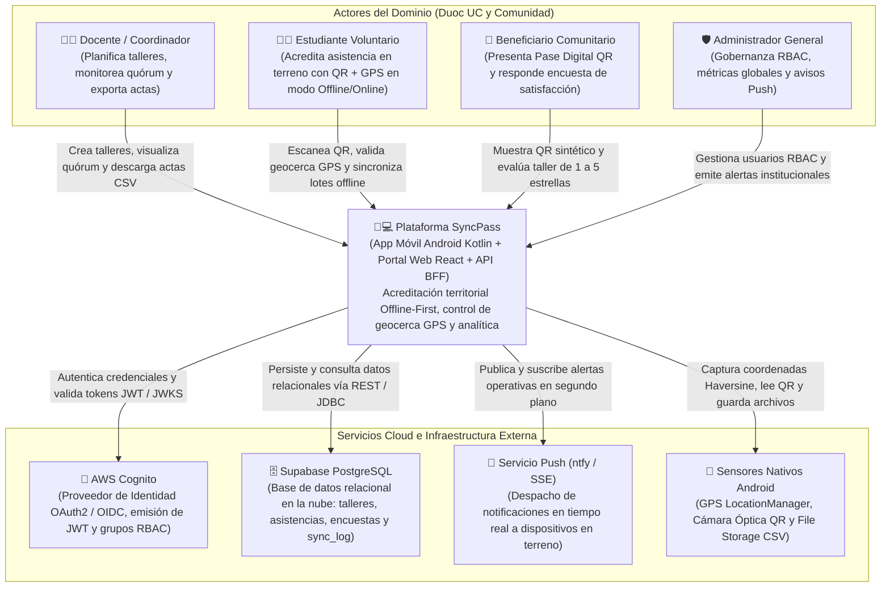

# Arquitectura de Software – SyncPass (Modelo C4)

**Proyecto:** SyncPass – Sistema de Acreditación Digital Territorial y Vinculación con el Medio  
**Asignatura:** Desarrollo de Aplicaciones Móviles Nativas (Kotlin) & Full Stack II · Duoc UC  
**Integrantes:** Mariano Acevedo · Álvaro León  

---

## 1. Visión General de la Arquitectura

**SyncPass** es una plataforma distribuida **Offline-First** diseñada para gestionar talleres territoriales comunitarios de Vinculación con el Medio en sectores con conectividad intermitente o nula. La solución integra una **Aplicación Móvil Nativa en Android (Kotlin + Jetpack Compose)**, un **Portal Web Administrativo (React + TypeScript)**, autenticación federada mediante **AWS Cognito (OAuth2 / OIDC + JWT)**, capa de servicios **API REST / BFF (Spring Boot en AWS EC2 y Serverless Functions)** y persistencia relacional centralizada en **PostgreSQL sobre Supabase**.

---

## 2. Nivel C1 – Diagrama de Contexto del Sistema

El Nivel C1 describe cómo **SyncPass** interactúa con los cuatro perfiles de usuario del dominio y con los sistemas externos de infraestructura cloud y hardware.



### Explicación de Interacciones en Nivel C1
1. **Docente / Coordinador:** Utiliza tanto el Dashboard Web como la App Móvil para crear talleres territoriales, proyectar el código QR del evento, supervisar el porcentaje de quórum en vivo y exportar el acta oficial en formato CSV.
2. **Estudiante Voluntario:** Opera en terreno (sedes vecinales) utilizando la App Android. Incluso sin internet, registra asistencias mediante lectura QR o RUT manual validando su posición con el GPS del teléfono. Al recuperar señal, ejecuta la sincronización por lotes hacia la nube.
3. **Beneficiario Comunitario:** Vecino o adulto mayor identificado mediante un código sintético (`BEN-XXXXX`, protegiendo datos personales). Presenta su QR digital y responde la encuesta de impacto al finalizar la jornada.
4. **Administrador General:** Supervisa las métricas globales de impacto territorial, administra el control de acceso basado en roles (RBAC) y emite notificaciones push hacia las cuadrillas en terreno.

---

## 3. Nivel C2 – Diagrama de Contenedores

El Nivel C2 detalla los contenedores ejecutables y almacenes de datos que conforman el ecosistema **SyncPass**, mostrando el flujo exacto:  
`App Móvil / Web -> API Gateway / BFF -> AWS Cognito -> EC2 (Spring Boot) / Serverless API -> Supabase PostgreSQL`.

```mermaid
flowchart LR
    subgraph Cliente["Dispositivos Cliente"]
        ANDROID["📱 App Móvil Android<br/>(Kotlin, Jetpack Compose, Coroutines)<br/>MVVM + Offline-First"]
        ROOM["💾 Almacenamiento Local<br/>(Room / SQLite + File Storage)<br/>Tablas: evento_taller_local,<br/>registro_asistencia_local,<br/>encuesta_valoracion_local"]
        WEB["💻 Portal Web SyncPass<br/>(React 19, TypeScript, Vite, Wouter)<br/>SPA Desplegada en Vercel"]
    end

    subgraph CloudAWS["Seguridad y Enrutamiento Cloud"]
        COGNITO["🔐 AWS Cognito<br/>User Pool: us-east-1_RlB8Ft9Z2<br/>OAuth2 Authorization Code + PKCE / JWT"]
        APIGW["🌐 API Gateway / Edge Router<br/>Enrutamiento HTTPS, CORS y<br/>validación de cabeceras"]
    end

    subgraph BackendLayer["Capa de Backend (BFF & Microservicios)"]
        SPRING["⚙️ Backend API REST<br/>(Spring Boot 3 / Java 21 en AWS EC2 :8080<br/>+ Serverless BFF `/api/*`)<br/>Controladores: Talleres, Asistencias,<br/>Encuestas, Usuarios, Notificaciones"]
    end

    subgraph DataLayer["Persistencia y Mensajería Cloud"]
        SUPA["🗄️ PostgreSQL en Supabase<br/>(nxbsqkpnkawbkdksmnym.supabase.co)<br/>9 Tablas DDL + Auditoría `sync_log`"]
        NTFY_SRV["🔔 Broker Push Ntfy<br/>Canal SSE en tiempo real"]
    end

    ANDROID <-->|Lectura/Escritura Offline-First<br/>(is_synced = false / true)| ROOM
    ANDROID -->|1. Login OAuth2 / PKCE| COGNITO
    WEB -->|1. Login OIDC / Sesión RBAC| COGNITO

    ANDROID -->|2. Peticiones HTTPS JSON<br/>(Retrofit + OkHttp)| APIGW
    WEB -->|2. Peticiones HTTPS JSON<br/>(Fetch API nativa)| APIGW

    APIGW -->|3. Redirige tráfico REST| SPRING
    SPRING -->|4. Verifica firma JWT (JWKS)| COGNITO
    SPRING <-->|5. Consultas e Inserciones Transaccionales<br/>(PostgREST / JDBC PostgreSQL)| SUPA
    SPRING -->|6. Dispara Push Server-to-Server| NTFY_SRV
    NTFY_SRV -.->|7. Stream SSE Background| ANDROID
```

### Flujo de Comunicación entre Contenedores (Nivel C2)
1. **Autenticación (`Cognito`):** La App Android (mediante el módulo `:cognito-auth` con AppAuth OAuth2) y la SPA Web autentican al usuario contra el User Pool `us-east-1_RlB8Ft9Z2`, obteniendo un `access_token` / `id_token` JWT que contiene los claims de identidad y rol (`coordinator`, `volunteer`, `attendee`, `admin`).
2. **Operación Local (`Room / SQLite`):** Cuando el voluntario registra asistencias o el beneficiario responde una encuesta sin conexión, la App Android almacena las entidades en `AppDatabase` (`Room`) con `sincronizado = false`.
3. **Sincronización e Integración (`API Gateway -> Spring Boot / BFF -> Supabase`):** Al presionar el botón **"Sincronizar Registros Pendientes"** (o al crear un taller en línea), `Retrofit` envía el lote JSON a través de HTTPS hacia los endpoints REST (`/api/talleres`, `/api/asistencias`, `/api/encuestas`, `/api/usuarios`), los cuales persisten los registros en **Supabase PostgreSQL** y registran la trazabilidad en la tabla `sync_log`.

---

## 4. Nivel C3 – Diagrama de Componentes de la Aplicación Móvil (MVVM + Clean Architecture)

El Nivel C3 hace zoom dentro del contenedor **App Móvil Android (`com.example.kotlin_login`)**, evidenciando la separación estricta en capas (**View**, **ViewModel + UiState**, **Domain Repository Interface**, **Data Repository Implementation**, **Local & Remote DataSources**, **Room DAO / Retrofit Service**, **Inyección de Dependencias `di/`** y **APIs de Hardware Nativo**).

```mermaid
flowchart TB
    subgraph ViewLayer["1. Capa de Vista (ui/* — Jetpack Compose)"]
        SCREENS["@Composable Screens<br/>LoginScreen · HomeScreen<br/>DocenteScreen · VoluntarioScreen<br/>BeneficiarioScreen · AdminScreen"]
        COMPONENTS["@Composable Components<br/>SyncPassTopBar · QrCodeView<br/>QrScannerView · AuthCard"]
    end

    subgraph ViewModelLayer["2. Capa de Presentación y Estado (ui/* — ViewModel & UiState)"]
        VM["ViewModels<br/>LoginViewModel · HomeViewModel<br/>DocenteViewModel · VoluntarioViewModel<br/>BeneficiarioViewModel · AdminViewModel"]
        UISTATE["Inmutable UI States (StateFlow)<br/>DocenteUiState · VoluntarioUiState<br/>BeneficiarioUiState · AdminUiState"]
    end

    subgraph DomainLayer["3. Capa de Dominio (domain/* — Pura, sin dependencias de frameworks)"]
        DOM_REPO["<<interface>><br/>SyncPassRepository<br/>(Contrato de acceso para el dominio)"]
        MODELS["Modelos de Dominio<br/>TallerEvento · AsistenciaRegistro<br/>EncuestaSatisfaccion · UserRole"]
    end

    subgraph HardwareLayer["4. Integración de Hardware Nativo (core/hardware/*)"]
        GPS_HW["LocationHardwareHelper<br/>(API Nativa #1: LocationManager + Geocerca Haversine)"]
        CAM_HW["QrCameraHardwareHelper<br/>(API Nativa #2: CameraManager + Parser QR)"]
        FILE_HW["ActaStorageHelper<br/>(API Nativa #3: File Storage CSV)"]
    end

    subgraph DataLayer["5. Capa de Datos (data/* — Repositorio y Fuentes de Datos)"]
        REPO_IMPL["SyncPassRepositoryImpl<br/>(Orquestador Offline-First y Sincronización Batch)"]
        LOCAL_DS["<<interface>> SyncPassLocalDataSource<br/>SyncPassLocalDataSourceImpl"]
        REMOTE_DS["<<interface>> SyncPassRemoteDataSource<br/>SyncPassRemoteDataSourceImpl"]
    end

    subgraph DriversLayer["6. Drivers de Persistencia y Red (data/local & data/remote)"]
        DAO["@Dao SyncPassDao & AppDatabase<br/>(Entidades Room: TallerEntity,<br/>AsistenciaEntity, EncuestaEntity)"]
        RETROFIT["SyncPassApiService (Retrofit + OkHttp)<br/>DTOs con @SerializedName:<br/>TallerRemoteDto, AsistenciaRemoteDto, EncuestaRequestDto"]
    end

    subgraph DILayer["7. Inversión e Inyección de Dependencias (di/*)"]
        DI_MOD["Módulos Singleton<br/>NetworkModule · DatabaseModule · RepositoryModule"]
    end

    SCREENS -->|Invoca eventos onAction()| VM
    VM -->|Expone StateFlow<UiState>| UISTATE
    UISTATE -->|Recompone declarativamente| SCREENS
    SCREENS --> COMPONENTS

    VM -->|Depende solo de la interfaz| DOM_REPO
    VM -->|Consulta sensores nativos| GPS_HW
    VM -->|Valida cámara y QR| CAM_HW
    VM -->|Exporta acta CSV| FILE_HW

    REPO_IMPL -.->|Implementa| DOM_REPO
    REPO_IMPL -->|Lee/Escribe caché y pendientes| LOCAL_DS
    REPO_IMPL -->|Sincroniza vía HTTPS| REMOTE_DS

    LOCAL_DS -->|Ejecuta queries locales| DAO
    REMOTE_DS -->|Ejecuta llamadas REST| RETROFIT

    DI_MOD -.->|Inyecta instancias únicas (@Singleton)| VM
    DI_MOD -.->|Cablea interfaces con implementaciones| REPO_IMPL
```

### Responsabilidades Estrictas por Capa en Android (Nivel C3)

| Capa / Paquete | Clases Principales | Responsabilidad Arquitectónica (Principio de Responsabilidad Única) |
| :--- | :--- | :--- |
| **Vista (`ui/*Screen.kt`, `ui/components/*`)** | `DocenteScreen`, `VoluntarioScreen`, `BeneficiarioScreen`, `AdminScreen`, `QrScannerView` | Funciones `@Composable` puras. Solo renderizan el `UiState` recibido desde su `ViewModel` y delegan interacciones del usuario mediante callbacks (`onCodeScanned`, `onSyncPendingClick`, `onCreateTaller`). **No contienen lógica de negocio ni llamadas a red/BD.** |
| **ViewModel y Estado (`ui/*ViewModel.kt`, `ui/*UiState.kt`)** | `VoluntarioViewModel`, `DocenteViewModel`, `BeneficiarioViewModel`, `AdminViewModel` | Administran el estado reactivo mediante `MutableStateFlow<UiState>`, ejecutan corrutinas en `viewModelScope`, invocan los helpers de hardware y se comunican **exclusivamente con la interfaz `SyncPassRepository`**. |
| **Dominio (`domain/model`, `domain/repository`)** | `SyncPassRepository` (Interfaz), `TallerEvento`, `AsistenciaRegistro`, `EncuestaSatisfaccion` | Núcleo del negocio independiente de librerías externas. Define los modelos puros y el contrato `SyncPassRepository` aplicando **Inversión de Dependencias (SOLID - DIP)**. |
| **Repositorio (`data/repository`)** | `SyncPassRepositoryImpl`, `AuthRepository` | Implementa `SyncPassRepository`. Decide cuándo leer/escribir en la fuente local (`SyncPassLocalDataSource`) y cuándo sincronizar lotes pendientes con la fuente remota (`SyncPassRemoteDataSource`). |
| **DataSources (`data/datasource`)** | `SyncPassLocalDataSource`, `SyncPassRemoteDataSource` | Desacoplan el repositorio de las librerías concretas (`Room` y `Retrofit`). Transforman DTOs de red y Entities locales sin filtrar anotaciones HTTP o SQL hacia las capas superiores. |
| **Persistencia Local (`data/local`)** | `AppDatabase`, `SyncPassDao`, `TallerEntity`, `AsistenciaEntity`, `EncuestaEntity` | Implementa el almacenamiento local en el dispositivo con soporte para bandera `sincronizado: Boolean` (`0 = pendiente`, `1 = sincronizado`). |
| **Cliente Remoto (`data/remote`)** | `SyncPassApiService`, `SyncPassRemoteDtos` (`@SerializedName`) | Define los contratos HTTP (`@GET`, `@POST`, `@DELETE`) gestionados por `Retrofit` y `OkHttpClient` con `HttpLoggingInterceptor`. |
| **Inyección de Dependencias (`di/`)** | `NetworkModule`, `DatabaseModule`, `RepositoryModule` | Provee instancias únicas (`@Singleton` / `by lazy`) de `OkHttpClient`, `Retrofit`, `AppDatabase`, `DataSources` y `SyncPassRepository`, reduciendo el consumo de memoria RAM y batería en el dispositivo móvil. |
| **Hardware Nativo (`core/hardware/`)** | `LocationHardwareHelper`, `QrCameraHardwareHelper`, `ActaStorageHelper` | Integración con **3 APIs nativas de Android**: (1) `LocationManager` + cálculo Haversine de geocerca a 150m, (2) `CameraManager` + decodificación de QR institucional, y (3) `File Storage` para exportación de actas CSV en el almacenamiento interno. |
